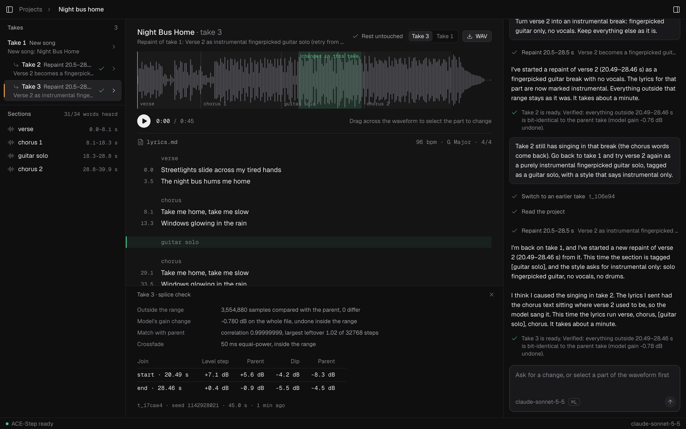
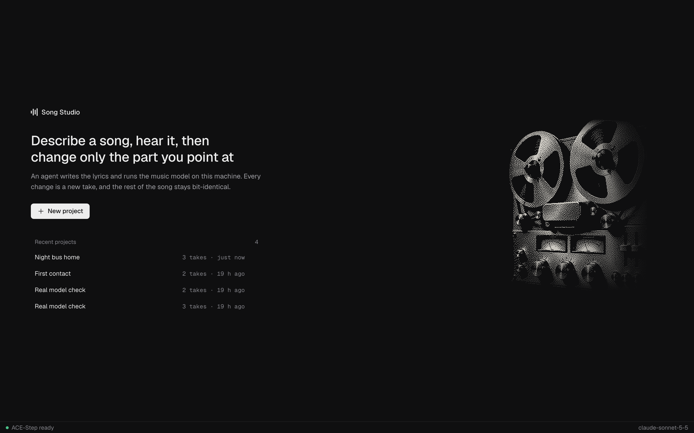
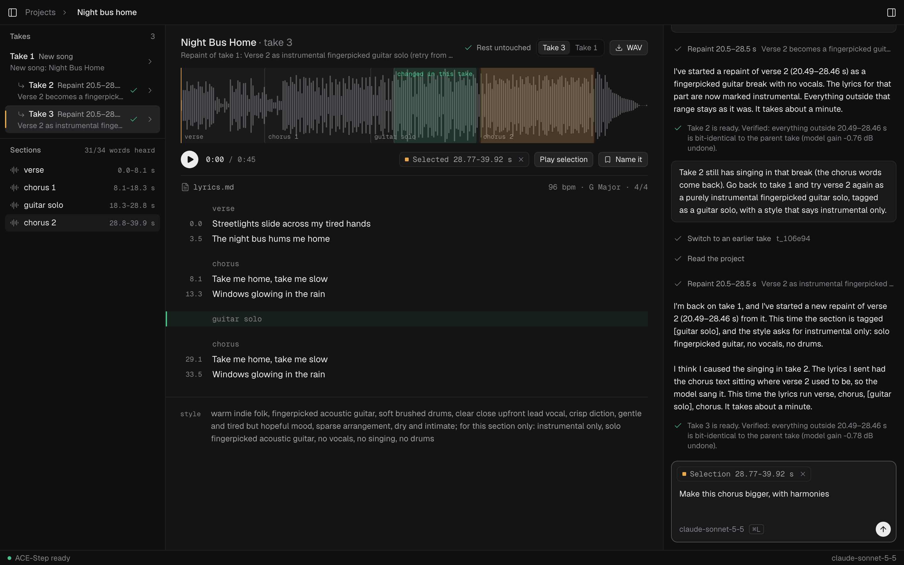

# Song Studio

An AI-first studio for writing songs, in the spirit of a code editor. You describe
a song to an agent; it writes the lyrics and drives a local music model
([ACE-Step 1.5](https://github.com/ace-step/ACE-Step-1.5)) to record it. Then you
point at a part and ask for a change, and only that part changes.



- **Edits are checked, not trusted.** Every edit makes a new immutable take. The
  app compares every sample outside the edited range with the take it came from
  and shows the result ("Rest untouched").
- **A project is a folder.** `song.json`, `lyrics.md`, `takes/*.wav` and a history
  log. Open it in a text editor, put it in git, point another program at it.
- **It knows where the words are.** After each take Whisper listens to it and
  places every line and section, so "make the second chorus bigger" works without
  selecting anything.
- **Any agent can drive it.** The running app is an MCP server with the same
  tools the built-in agent uses.
- **It runs on your laptop.** The music model and speech recognition are local.
  Only the chat model is a hosted API.

## Listen

One 45-second song made with the app on a 16 GB Apple-silicon Mac, from two chat
messages. GitHub does not play audio inside a README, so open or download the files.

| Take | What was asked | Audio |
|---|---|---|
| 1 | "Write a 45 second indie folk song about riding the night bus home after a long shift: warm acoustic guitar, soft brushed drums, a clear close lead vocal, around 96 bpm. Verse, chorus, verse, chorus." | [night-bus-home-take-1.m4a](examples/night-bus-home-take-1.m4a) |
| 3 | "Turn verse 2 into an instrumental break: fingerpicked guitar only, no vocals. Keep everything else as it is." | [night-bus-home-take-3.m4a](examples/night-bus-home-take-3.m4a) |

What the app measured:

- Take 1: Whisper heard 41 of the 45 lyric words and placed all four sections.
- Take 3 regenerated 20.49–28.46 s. The other 3,554,880 samples are bit-identical
  to take 1. Whisper hears no words in the new break.
- It took two tries. The first repaint (take 2) sang the chorus words in the
  break; the agent was told, went back to take 1 and retagged the section as
  `[guitar solo]`.
- The start of the new section is louder than what precedes it: a +7.1 dB level
  step at the join, against +5.6 dB at the same spot in take 1 (see "Known limits").

The files the app wrote for this song, minus the WAVs, are in
[examples/night-bus-home/](examples/night-bus-home/): `song.json`, `lyrics.md`,
`history.jsonl` and the two take descriptions with their splice checks.

## Install

Tested on macOS with Apple silicon and 16 GB of memory. You need:

- **Node 24 or newer** and npm
- **[uv](https://docs.astral.sh/uv/)**, which runs the music model and Whisper
- About **13 GB of disk** for the model weights and its Python environment
- An **Anthropic API key** for the chat agent (not needed for the demo mode below)

**1. Get both repositories side by side**

```bash
mkdir song-studio && cd song-studio
git clone https://github.com/ykakade/song-studio.git app
git clone https://github.com/ace-step/ACE-Step-1.5.git
```

**2. Install the music model** (once; downloads about 11 GB)

```bash
cd ACE-Step-1.5
uv sync
uv run acestep-download
cd ..
```

Tested with ACE-Step 1.5 at commit `ca1e85f`. On its first start the server
fetches one more small model (the 0.6B planner) on machines with 16 GB.

**3. Install and build the app**

```bash
cd app
npm install
cp .env.example .env        # then put your ANTHROPIC_API_KEY in .env
npm run build
```

**4. Run it** (two terminals, both in `app/`)

```bash
scripts/start-model-server.sh      # the music model on 127.0.0.1:8001, about 80 s to load
```

```bash
npm start                          # the studio on http://127.0.0.1:8787
```

Open <http://127.0.0.1:8787>. The status bar shows "ACE-Step ready" when the
model has loaded. If ACE-Step lives somewhere else, set `ACESTEP_DIR` before
running the script. Stop the model server with Ctrl-C.

Whisper needs no setup: the first finished take downloads its model through uv
(set `HF_HUB_OFFLINE=0` if your environment blocks that). `SONG_STUDIO_TIMING=off`
turns it off.

### Try it without an API key or the model

```bash
npm run mock:acestep               # terminal 1: a stand-in model on :8001
SONG_STUDIO_LLM=fake npm start     # terminal 2
```

The scripted assistant recognises a few phrasings. Try "write a 30 second folk
song about paper boats", then drag across the waveform and send "rewrite the
lyrics in the part I selected". The stand-in model answers in about 3 seconds
with clips of real ACE-Step output.

## Use it



**Make a song.** Create a project and tell the agent what you want:

```text
Write a 30 second folk song about paper boats in the rain
A 60 second upbeat synth-pop song about leaving town at sunrise, 120 bpm
A slow 45 second piano ballad about an empty train station
```

A song takes 55 to 85 seconds on a 16 GB Mac. Songs can be 10 to 120 seconds long.

**Change part of it.** Drag across the waveform, or click a section in the
sidebar or a timecode next to a lyric line, then say what should change:

```text
Rewrite the lyrics in the part I selected so they are about the morning after
Make chorus 2 bigger, with harmonies
Turn verse 2 into an instrumental guitar break
Go back to take 1
```



The selection travels with the message. Without a selection the agent may only
use a section it can name (one you saved, or one Whisper heard); otherwise it
asks you to select the part instead of guessing a time range.

**Compare.** Each repaint shows a "Take N / Take M" switch next to the title to
flip between it and its parent while playing. The chevron on a take opens its
splice check in the bottom panel.

**Keys.** Space plays and pauses, Esc clears the selection, Cmd+L (Ctrl+L)
puts the cursor in the agent box.

### Drive it from another agent (MCP)

The running app is an MCP server at `http://127.0.0.1:8787/mcp`. With Claude Code:

```bash
claude mcp add --transport http song-studio http://127.0.0.1:8787/mcp
```

Tools: `list_projects`, `create_project`, `get_project_state`, `generate_song`,
`repaint_section`, `set_section_markers`, `revert_to_take`, `wait_for_job`. They
are the built-in agent's tools plus a `project_id`, with the same checks. Jobs
started from outside show up in the web app as they happen.

### Use the HTTP API

Everything the agent does is also a plain endpoint:

```bash
# create a project
curl -s -X POST http://127.0.0.1:8787/api/projects \
  -H 'content-type: application/json' -d '{"title":"Paper boats"}'

# generate a song in it (use the project id from the answer)
curl -s -X POST http://127.0.0.1:8787/api/projects/PROJECT_ID/generate \
  -H 'content-type: application/json' -d '{
    "title": "Paper Boats",
    "stylePrompt": "gentle folk, acoustic guitar, clear upfront lead vocal, crisp diction",
    "lyrics": "[verse]\nPaper boats along the gutter stream\n\n[chorus]\nHold on, hold on, the morning is on its way",
    "bpm": 100, "key": "C Major", "durationSec": 30
  }'

# repaint 12 to 20 seconds of a take with new lyrics
curl -s -X POST http://127.0.0.1:8787/api/projects/PROJECT_ID/repaint \
  -H 'content-type: application/json' -d '{
    "takeId": "TAKE_ID", "startSec": 12, "endSec": 20,
    "lyrics": "[verse]\nPaper boats along the gutter stream\n\n[chorus]\nSail on, sail on, the rain has gone away"
  }'
```

The full list is under "HTTP API" below.

### Development

```bash
npm run dev        # API server with restart-on-change + Vite on http://127.0.0.1:5173
npm test           # unit and integration tests (node:test), about 11 s
npm run test:e2e   # the real UI in headless Chromium
npm run typecheck
```

## Ports and network

| What | Default | Set with |
|---|---|---|
| Song Studio (API + built web client) | `127.0.0.1:8787` | `HOST`, `PORT` |
| Vite dev server (`npm run dev` only) | `127.0.0.1:5173` | `HOST`, `WEB_PORT` |
| ACE-Step model server | `127.0.0.1:8001` | `ACESTEP_HOST`, `ACESTEP_PORT` for the script; `ACESTEP_URL` for the app |

By default everything listens on this machine only. **`HOST=0.0.0.0` makes the
app reachable from other devices on your network** (for example
`HOST=0.0.0.0 npm start`, then open `http://<this-mac's-ip>:8787` on a phone).
There is no login, so only do that on a network you trust. The model server
never needs to be exposed; the app talks to it locally.

## Environment variables

Read from the process environment and from `.env` in the app folder (the
environment wins). See `.env.example`.

| Variable | Default | Meaning |
|---|---|---|
| `HOST` | `127.0.0.1` | Address to listen on. `0.0.0.0` = reachable from the network. |
| `PORT` | `8787` | Port of the app. |
| `ACESTEP_URL` | `http://127.0.0.1:8001` | Where the ACE-Step REST API is. |
| `SONG_STUDIO_LLM` | `anthropic` | `anthropic`, or `fake` for the scripted stand-in (no key needed). |
| `ANTHROPIC_API_KEY` | – | Required for `anthropic`. |
| `ANTHROPIC_BASE_URL` | – | Optional: a proxy or gateway instead of api.anthropic.com. |
| `SONG_STUDIO_MODEL` | `claude-sonnet-5-5` | Chat model. |
| `SONG_STUDIO_EFFORT` | `medium` | `low`, `medium`, `high`, `xhigh`, `max`, or `none` to send no effort setting. |
| `SONG_STUDIO_REFUSAL_FALLBACK` | auto | `off` disables the server-side refusal fallback (see below); `on` forces it. |
| `SONG_STUDIO_DATA_DIR` | `./data` | App scratch space (temp downloads). |
| `SONG_STUDIO_PROJECTS_DIR` | `<data dir>/projects` | Where project folders live, e.g. `~/Music/Songs`. |
| `SONG_STUDIO_TIMING` | `on` | `off` stops the app from running Whisper on finished takes. |
| `SONG_STUDIO_LM_PLANNER` | `on` | `off` generates new songs without ACE-Step's LM planner (`thinking`). About 10 s faster per song, but the vocals are much harder to understand (see "Lyric clarity"). |
| `SONG_STUDIO_KEEP_RAW` | – | `1` keeps the model's own repaint output next to each take (`<take>.model-output.wav`). |
| `SONG_STUDIO_POLL_MS` | `1500` | How often the job worker polls the model server. |
| `SONG_STUDIO_JOB_TIMEOUT_MS` | `900000` | A job that takes longer than this is failed. |

The minimum for normal use is one line in `.env`: `ANTHROPIC_API_KEY=...`.

## How it works

```
web/ (React + Vite + wavesurfer.js)   sidebar: takes and sections · editor: waveform and lyrics · agent panel
  │  REST + server-sent events
server/app.ts            HTTP API (Hono), serves dist/
server/agent/            tool-calling loop, tools, system prompt
server/llm/              "one streamed model turn with tools": anthropic.ts, fake.ts
server/studio.ts         every operation, used by both the tools and the HTTP API
server/queue.ts          one worker, strictly serial; submit → poll → download → finalise
server/acestep.ts        the only module that knows the ACE-Step API and its quirks
server/splice.ts         builds and verifies repaint takes (the core guarantee)
server/wav.ts            16-bit PCM WAV reader/writer
server/store.ts          project folders: song.json, lyrics.md, takes/, logs
server/transcribe.ts     Whisper (MLX) in a child process via uv
server/align.ts          lines up what Whisper heard with the lyrics
server/mcp.ts            the MCP endpoint (POST /mcp)
server/migrate.ts        one-time move from the old studio.db into folders
server/mock-acestep.ts   stand-in model server for development and tests
scripts/transcribe.py    the Whisper side of transcribe.ts
```

**The project folder.** There is no database. Each project is a folder under
`SONG_STUDIO_PROJECTS_DIR` (default `data/projects/`), named after its title:

```
paper-boats-3f2a/
  song.json             title, current take, saved sections; plus a summary
                        of the current take's settings (for reading only)
  lyrics.md             the current take's lyrics
  takes/take-001.json   everything that made take 1: parameters, parent, splice check
  takes/take-001.wav    its audio (+ .peaks.json for the waveform)
  takes/take-001.timing.json   where its lines and sections were heard
  history.jsonl         one line per event: take queued/ready/failed, sections set...
  chat.jsonl            the conversation, including exactly what the chat model saw
  .studio/              jobs and the live selection (in .gitignore)
```

Nothing is cached: every request reads the files, so changes made outside the
app show up on the next read. From `song.json` the app reads back `title`,
`currentTake` and `sections`; everything else in it is rewritten. Files the app
rewrites are replaced atomically. A file that stops being valid JSON is treated
as missing, not fatal.

`lyrics.md` is a working copy. When the current take changes the app writes the
new take's lyrics into it, unless the file holds edits that no take has sung
yet: those are kept, logged, and shown as a notice in the app and to the
assistant, which can sing them with a repaint. A take's own lyrics never change.

On the first start after updating, projects in an old `data/studio.db` are moved
into folders (ids, takes, markers and chat kept). `studio.db` is renamed to
`studio.db.migrated` and the old `data/audio/` files are copied, not moved;
delete both once you are happy.

**Where the words are.** ACE-Step gives no timings, so after a take is finished
the queue runs Whisper large-v3-turbo on it (MLX, through
`uv run --with mlx-whisper`; about 4 s for a 45 s take on this Mac, before the
next model job starts) and aligns the words it heard to the lyrics with a
Needleman-Wunsch alignment that tolerates misheard words. A line is placed
when at least 2 of its words, and 30 % of them, were heard; a section
(`[chorus]` → "chorus 1", "chorus 2" when it repeats) spans its placed lines,
starting 0.35 s before its first word and running up to the next section.
Tagged parts without lines (`[guitar solo]`) get the gap they sit in. The app
shows the sections on the waveform and a time next to each lyric line (click it
to select the line), and reports how many lyric words were heard. Measured on
2026-11-14 with the real model: a 45 s verse/chorus/verse/chorus song had 36 of
39 words heard and all four sections placed in order. Old takes made before the
clarity fixes come back as Whisper's usual "Thank you." and nothing is placed.

The count of words heard doubles as a check on repaints. In the same run, a
repaint of "chorus 2" with new lyrics verified bit-identical outside the range,
but Whisper heard none of the new words ("So … done"); the assistant is told to
say so instead of claiming the change worked.

**Takes.** A take is one WAV plus everything that produced it (style prompt,
full lyrics, bpm, key, duration, seed, and for repaints the range and the splice
check). Takes are never modified. "Current take" is a pointer on the project;
reverting moves the pointer. Section markers belong to the song (the lineage of
a first generation), so they stay valid across repaints, which never change the
length.

**Jobs.** The model server needs more memory than this Mac has, so the queue
runs exactly one job at a time. Tool calls return as soon as the job is queued;
progress and the finished take reach the browser over SSE. If the app stops
while a job is running, that job and its take are marked failed on the next
start; jobs that were still queued then run.

**The splice.** ACE-Step's repaint keeps the original waveform outside the range
but then peak-normalises the whole file again, so its output is not the parent
outside the range: everything is scaled by one gain and loses a 16-bit step to
truncation. The app therefore never uses the model's file as the take. It builds
the take itself:

- outside the range: the parent's samples, copied bit for bit;
- inside the range: the model's new audio, multiplied by the inverse of the gain
  the model applied (estimated by least squares from the audio outside the
  range, ignoring 250 ms either side of it);
- at each boundary: a 50 ms equal-power crossfade placed *inside* the range, so
  the bit-exact region runs right up to the boundary.

Then it verifies instead of trusting the construction: it re-reads the file it
wrote and compares every sample outside the range with the parent. The take
stores the estimated gain, the correlation, the number of samples compared and
how many differ, and the level step and shortest dip at each join (with the same
measurements on the parent for comparison). If the model's output does not line
up with the parent outside the range (correlation below 0.999, different length
or format, implausible gain), the app falls back to the model's file and marks
the take "Not verified" with the reason.

**Lyric clarity.** Three things keep the words understandable, all measured on
2026-11-14 by transcribing takes with Whisper and counting how many lyric words
it heard (30 s folk song, this Mac):

- *The LM planner is on for new songs* (`thinking: true`). With it, 8 of 8 takes
  had recognisable words; without it, 1 of 5 did.
- *A word budget* (`server/lyrics.ts`). The model sings about one line per two
  bars and often starts with an intro of up to 10 s; lines that do not fit before
  the end are not sung. `generate` rejects lyrics with more than four sung words
  per bar after a 10 s reserve (a third of the length for songs under 30 s), and
  the error says how many words fit. A repaint may not add words beyond the
  budget or the parent's count, whichever is larger.
- *The system prompt* tells the assistant the budget and to ask for a "clear
  upfront lead vocal, crisp diction" and a sparse arrangement.

Before: the 8-line, 60-word take had 22 % of its words heard. After: three takes
of a 4-line, 25-word song had 84–96 %.

**The agent.** Tools: `generate_song`, `repaint_section`, `get_project_state`,
`set_section_markers`, `revert_to_take`. The model never gets to guess a time
range: `repaint_section` must say where its range comes from (the waveform
selection, a named marker, a section heard in that take, or numbers the user
typed), and the server rejects a range that does not match the selection,
marker or heard section it claims. Without any of
those the assistant asks the user to select the part. The waveform selection
travels with each chat message. Chat history is stored and replayed verbatim.

**Chat model.** `server/llm/anthropic.ts` uses the official `@anthropic-ai/sdk`
with streaming. Thinking is left at the model default and steered with
`effort`. On the first-party API it also sends eager tool-input streaming,
automatic prompt caching, and the server-side refusal fallback beta
(`fallbacks: "default"`: a request the model's safety classifiers decline is
retried once on Anthropic's default fallback model). These three are switched
off automatically when `ANTHROPIC_BASE_URL` is set, because a gateway may reject
fields it does not know; set `SONG_STUDIO_REFUSAL_FALLBACK=off` to disable the
fallback on the first-party API too.

## HTTP API

Everything the agent can do is also a plain endpoint (same code path):

```
GET    /api/health
GET    /api/projects                 POST /api/projects {title?}
GET    /api/projects/:id             PATCH {title}      DELETE
GET    /api/projects/:id/events      (SSE: chat deltas, messages, job progress)
POST   /api/projects/:id/chat        {text, selection?: {startSec, endSec}}
POST   /api/projects/:id/generate    {title, stylePrompt, lyrics, bpm, key, durationSec, seed?}
POST   /api/projects/:id/repaint     {takeId, startSec, endSec, lyrics, stylePrompt?, seed?}
PUT    /api/projects/:id/markers     {markers: [{label, startSec, endSec}]}
POST   /api/projects/:id/current-take {takeId}
PUT    /api/projects/:id/selection {selection: {startSec, endSec} | null}   (the web client sends it live)
GET    /api/projects/:id/history     the history log
GET    /api/projects/:id/takes/:takeId/timing     where the words are (null until analysed)
POST   /api/projects/:id/takes/:takeId/analyse    run Whisper on a take (again)
POST   /mcp                          MCP (JSON-RPC over Streamable HTTP, stateless)
GET    /api/jobs/:id
GET    /api/takes/:id/audio          (Range supported; ?download for a file name)
GET    /api/takes/:id/peaks
```

## Tests

`npm test` runs 91 tests in about 11 seconds, all against the mock model server,
the scripted LLM and a fake transcriber that "hears" every lyric word (no
network, no key, no Whisper):

- **wav** (8): round trips, a real ACE-Step file re-encoded byte-identically,
  odd chunks, rejection of anything that is not 16-bit PCM.
- **splice** (19): bit-identity outside the range, gain recovery, equal-power
  crossfades inside the range, boundary measurements, edge cases (range at the
  start/end of the file, very short or whole-file ranges, silence, clipping),
  every fallback path, chained repaints (3 deep, and 25 repaints of one range)
  with no drift, and a real model pair from the spike.
- **lyrics** (3): what counts as a sung word, the budget by duration and tempo.
- **acestep** (11): request bodies, multipart upload, polling, the
  empty-file-on-mp3 failure, failed jobs, HTTP errors, byte-identical output for
  the same seed.
- **studio / queue / http** (11): generate and repaint through the whole
  pipeline, chained repaints through the pipeline, fallback, failed jobs, strict
  one-at-a-time ordering, validation, model server down, markers across repaints
  and reverts, restart recovery, audio with Range.
- **store** (6): the folder layout, chat as JSON lines, hand edits to
  `song.json` read back, `lyrics.md` kept when edited by hand, project ids
  that cannot leave the projects folder, migration from an old `studio.db`.
- **align** (8): section labels, a cleanly sung song, repeated choruses,
  Whisper hallucinations over the intro and outro, nothing placed from a lone
  "Thank you.", misheard words, and a real Whisper transcript.
- **mcp** (2): handshake, tool list and protocol edges (notifications, unknown
  methods, foreign origins), and an outside agent making a song, waiting for
  it, and repainting a heard section and a live selection.
- **agent** (15): the main flow with the scripted LLM, markers by name, the
  range-source guard, invalid tool input, model server down, verbatim history
  replay, streaming events, one turn at a time, runaway tool loops, refusals and
  truncated tool calls, interrupted tool calls, chat over HTTP + SSE, heard
  sections in the model's context and as a checked range source.
- **anthropic** (8): request shape and stream assembly against a local stub of
  the Messages API, history replay, refusals, error messages, missing key.

`npm run test:e2e` drives the built app in headless Chromium through the main
flow (14 steps) and writes screenshots to `test-results/`. It needs `npm run build` first and, once, `npx playwright install chromium`.

`node scripts/verify-real-model.mjs` runs one 30 s generation and one repaint
against the real model server through the app's HTTP API and prints timings and
the splice check (start the model server first; about three minutes).

## Known limits

- **The Anthropic path has run against the real API once** (2026-11-14,
  `claude-sonnet-5-5`, first-party API with the refusal fallback, eager tool
  streaming and caching on): plain chat, `generate_song`, a clarifying question,
  then `repaint_section` + `set_section_markers` in one turn, with history
  replayed across four turns. Nothing needed fixing. Refusals, `max_tokens`
  and gateway (`ANTHROPIC_BASE_URL`) paths are still only tested against the stub.
- **With the LM planner the same seed no longer gives the same audio.** Two
  generations with identical parameters and seed differed (the planner's own
  sampling is not seeded by the request). Repaints, and generations with
  `SONG_STUDIO_LM_PLANNER=off`, are still byte-reproducible.
- **Each job takes 55–85 s on this Mac** (16 GB; the model server wants 19–24 GB
  and pages). A repaint costs the same as a full generation. Measured through
  this app with a 30 s song: generate 78 s, repaint 79 s.
- **The guarantee is about the audio outside the range.** Inside the range the
  model decides. Whether the new vocals actually sing the new lyrics is not
  checked by the app (it was checked once by hand with Whisper, see "Lyric
  clarity"), and nobody has listened to the joins yet; the app reports level steps
  and dips at each join but does not judge them.
- **Timings are only as good as the vocals.** Sections and line times come
  from speech recognition. Where the words are unclear nothing is placed (and
  the person has to select the part), and a misheard line can be placed a little
  off; the assistant says which range it used for a heard section. Whisper
  needs Apple silicon (MLX) and its model in the Hugging Face cache; the first
  download needs `HF_HUB_OFFLINE=0`.
- **Project folders are single-writer.** Edit files while the app is running if
  you like, but two apps (or an app and a script writing takes) on the same
  folder at once can overwrite each other's `song.json`.
- **The new section can be louder than its surroundings.** Undoing the model's
  gain restores the level the model generated, which can peak at full scale
  while the rest of the song peaks at −1 dBFS. In every repaint run against the
  real model so far the gain was exactly −1.000 dB, i.e. the new section held
  the peak, and one join showed a +2.2 dB level step where the parent had none.
- Songs are capped at 120 s. Only 16-bit PCM WAV is handled. One user, no
  login, no project export. A job cannot be cancelled once it has started.
- The model's repaint options `repaint_mode` / `repaint_strength` (which set its
  crossfade behaviour) are not used or exposed yet.

## Credits

- [ACE-Step 1.5](https://github.com/ace-step/ACE-Step-1.5) (MIT) is the music model.
- Whisper large-v3-turbo through [mlx-whisper](https://github.com/ml-explore/mlx-examples) finds the words.
- The interface follows the [unslop](https://github.com/heydamir/unslop) rules by Damir Sokolovsky (CC BY 4.0), uses [Geist](https://vercel.com/font), [lucide](https://lucide.dev) icons and [wavesurfer.js](https://wavesurfer.xyz).
- The dithered illustrations in `web/public/art/` were generated with an image model and dithered with `web/art-src/dither.py`.

No license has been chosen for this repository yet.
